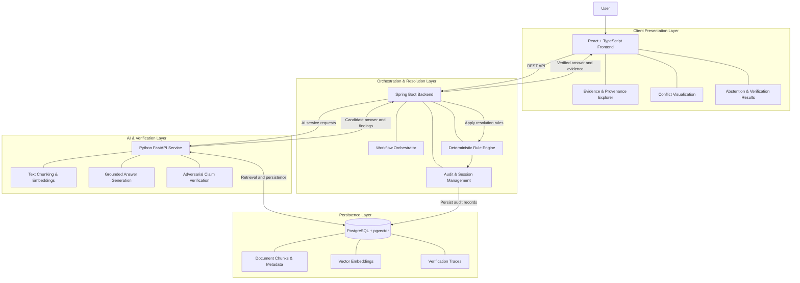

# 🛡️ TruthGuard
### Adversarial Verification System for Question Answering Over Inconsistent Document Corpora

**TruthGuard** is an evidence-grounded question-answering and verification system designed to handle contradictory, outdated, and inconsistent information across multiple documents.

Instead of blindly trusting the most relevant document or generating an answer from conflicting evidence, TruthGuard retrieves supporting passages, extracts factual claims, examines inconsistencies, and applies deterministic resolution rules before returning a response.

When the available evidence cannot support a reliable conclusion, the system explicitly abstains rather than inventing certainty.

> **Core principle:** Evidence before answers. Verification before resolution. Transparency over false confidence.

---

## 📌 Table of Contents

- [Key Features](#-key-features)
- [How TruthGuard Works](#-how-truthguard-works)
- [System Architecture](#-system-architecture)
- [Technology Stack](#-technology-stack)
- [Service Responsibilities](#-service-responsibilities)
- [Repository Structure](#-repository-structure)
- [Getting Started](#-getting-started)
- [Verification and Testing](#-verification-and-testing)
- [Design Principles](#-design-principles)
- [Project Status](#-project-status)

---

## ✨ Key Features

- **Evidence-Based Retrieval:** Combines dense semantic retrieval with lexical search to identify relevant document passages.
- **Grounded Answer Generation:** Produces candidate answers supported by retrieved evidence and links claims to their sources.
- **Adversarial Verification:** Examines candidate answers for contradictions, unsupported claims, and inconsistencies across documents.
- **Deterministic Conflict Resolution:** Applies explicit business rules to resolve conflicts instead of allowing an AI model to make the final decision.
- **Temporal Awareness:** Considers document versions, update timestamps, and applicable precedence rules when evaluating conflicting assertions.
- **Transparent Provenance:** Exposes supporting passages, source metadata, verification findings, and resolution decisions.
- **Explicit Abstention:** Returns an insufficient-evidence response when conflicting claims cannot be resolved reliably.
- **Auditable Decisions:** Records verification results and resolution traces for debugging and future review.

### The Problem TruthGuard Addresses

Traditional question-answering systems can retrieve multiple documents that appear relevant but disagree on the answer. A language model may overlook these disagreements, combine incompatible statements, or present an unsupported conclusion with confidence.

TruthGuard introduces a verification and arbitration layer between evidence retrieval and the final response.

| Conventional QA risk | TruthGuard approach |
|---|---|
| Contradictory documents | Extract and compare claims |
| Outdated information | Evaluate timestamps and version metadata |
| Unsupported statements | Verify claims against retrieved evidence |
| Ambiguous precedence | Apply explicit resolution rules |
| Unresolvable conflicts | Abstain with a reason |
| Difficult-to-audit answers | Preserve evidence and decision traces |

---

## 🔄 How TruthGuard Works

The system follows a structured, multi-stage verification pipeline.

1. **Document Ingestion** — Accept documents, extract their text, and preserve source metadata, version information, and timestamps.
2. **Chunking and Indexing** — Split documents into searchable passages and generate embeddings for semantic retrieval.
3. **Evidence Retrieval** — Retrieve relevant passages using vector similarity and lexical matching.
4. **Candidate Answer Generation** — Generate a preliminary answer grounded in the retrieved evidence.
5. **Claim Extraction** — Break the candidate answer and source passages into individual factual assertions.
6. **Adversarial Verification** — Compare assertions across sources to identify contradictions, unsupported claims, and temporal inconsistencies.
7. **Deterministic Arbitration** — Apply predefined precedence and consistency rules to determine whether a conclusion is justified.
8. **Response and Audit** — Return the answer with supporting evidence, detected conflicts, and the resolution rationale, or abstain when the evidence is insufficient.

### Conflict Resolution Logic

TruthGuard uses document recency as a potential precedence signal, not as automatic proof of correctness.

- **Consistent evidence:** If applicable sources support the same claim, return the grounded answer.
- **Resolvable conflict:** If a documented precedence rule clearly determines which assertion applies, return the result with its rationale.
- **Unresolvable conflict:** If equally applicable sources contradict one another and no valid rule resolves the disagreement, abstain.
- **Insufficient evidence:** If the retrieved material does not support a reliable answer, report that the available evidence is insufficient.

For documents updated simultaneously, the system must compare their assertions and applicable metadata. Matching timestamps alone do not establish which document is correct.

---

## 🏗️ System Architecture

TruthGuard uses a decoupled architecture that separates the user interface, workflow orchestration, AI-based analysis, and persistent storage.



### Architecture Overview

| Layer | Responsibility |
|---|---|
| Frontend | Question submission, evidence inspection, conflict visualization, and response presentation |
| Spring Boot Backend | Request orchestration, workflow management, deterministic arbitration, and audit logging |
| Python AI Service | Embedding generation, evidence analysis, candidate answer generation, and claim verification |
| PostgreSQL + pgvector | Persistent document storage, vector indexing, metadata, and verification records |

The backend remains the authority for final resolution decisions. The AI service supplies evidence and verification findings but does not independently determine the final outcome.

---

## 🧰 Technology Stack

| Component | Technology |
|---|---|
| Frontend | React 18, TypeScript, Vite |
| Backend | Java 17, Spring Boot 3, Maven |
| AI Service | Python 3.14, FastAPI, Uvicorn |
| Validation and Configuration | Pydantic |
| Database | PostgreSQL 16 |
| Vector Search | pgvector |
| Vector Indexing | HNSW / IVFFlat |
| Testing | JUnit 5, MockMvc, pytest |
| Containerization | Docker Compose |
| Communication | REST APIs |

---

## 🧩 Service Responsibilities

### 1. Frontend — `frontend/`

**Technology:** React, TypeScript, Vite

Responsibilities:
- Submit natural-language questions.
- Display answers and supporting document passages.
- Highlight conflicting assertions.
- Present source metadata and provenance.
- Explain why the system returned an answer or abstained.
- Display service health and verification status.

**Boundary:** The frontend communicates through backend APIs and does not directly access the database or orchestrate AI models.

### 2. Core Backend — `backend/`

**Technology:** Java 17, Spring Boot 3, Maven

Responsibilities:
- Coordinate the end-to-end question-answering workflow.
- Manage ingestion requests and application state.
- Communicate with the AI service.
- Apply deterministic conflict-resolution policies.
- Enforce evidence and abstention requirements.
- Persist audit records and resolution outcomes.
- Expose REST endpoints to the frontend.

**Boundary:** The backend owns business rules and final resolution decisions. Computationally intensive embedding and AI inference tasks belong in the AI service.

### 3. AI Service — `ai-service/`

**Technology:** Python 3.14, FastAPI, Uvicorn

Responsibilities:
- Process documents and split text into chunks.
- Generate embeddings for semantic retrieval.
- Retrieve or analyze relevant evidence.
- Generate evidence-grounded candidate answers.
- Extract atomic factual claims.
- Detect contradictions and unsupported assertions.
- Return structured findings to the backend.

**Boundary:** The AI service reports its findings but does not override deterministic backend policies or independently declare conflicting claims to be true.

### 4. Persistence Layer — `docker-compose.yml`

**Technology:** PostgreSQL 16, pgvector

Responsibilities:
- Store document chunks and source metadata.
- Persist vector embeddings and support similarity search.
- Maintain document version and timestamp information.
- Store conflict findings and verification traces.
- Support reproducible investigation of resolution decisions.

**Boundary:** Database access follows the application's configured access and persistence policies.

---

## 📂 Repository Structure

```text
TruthGuard/
├── backend/
│   ├── pom.xml
│   ├── README.md
│   └── src/
│       ├── main/
│       │   ├── java/com/truthguard/
│       │   │   ├── TruthGuardApplication.java
│       │   │   ├── controller/
│       │   │   │   └── HealthController.java
│       │   │   └── dto/
│       │   │       └── HealthResponse.java
│       │   └── resources/
│       │       └── application.yml
│       └── test/
│           └── java/com/truthguard/
│               ├── TruthGuardApplicationTests.java
│               └── controller/
│                   └── HealthControllerTest.java
│
├── ai-service/
│   ├── pyproject.toml
│   ├── requirements.txt
│   ├── README.md
│   ├── app/
│   │   ├── main.py
│   │   ├── config.py
│   │   ├── schemas/
│   │   │   └── health.py
│   │   └── api/
│   │       └── health.py
│   └── tests/
│       └── test_health.py
│
├── frontend/
│   ├── package.json
│   ├── tsconfig.json
│   ├── vite.config.ts
│   ├── index.html
│   └── src/
│       ├── App.tsx
│       ├── main.tsx
│       ├── index.css
│       ├── App.css
│       ├── types/
│       └── components/
│
├── docker/
│   └── initdb/
│       └── 01-init.sql
│
├── docker-compose.yml
├── .env.example
├── .gitignore
└── README.md
```

---

## 🚀 Getting Started

### Prerequisites

Ensure the following tools are installed:

- Java 17
- Maven
- Python 3.14, or another version supported by the project's dependencies
- Node.js and npm
- Docker Desktop with Docker Compose, or a local PostgreSQL 16 installation

### 1. Start the Database

**Recommended: Docker Compose**

From the repository root:

```bash
docker compose up -d
```

This starts the configured PostgreSQL and pgvector container on port `5432` and executes the initialization script on first database initialization.

Verify the container:

```bash
docker compose ps
```

**Alternative: Local PostgreSQL**

Ensure PostgreSQL is running, then enable pgvector:

```bash
psql -U postgres -h localhost -p 5432 \
  -c "CREATE EXTENSION IF NOT EXISTS vector;"
```

Configure your database credentials and connection settings in the relevant environment configuration.

### 2. Start the Spring Boot Backend

Open a terminal:

```bash
cd backend
mvn clean test
mvn spring-boot:run
```

The backend is expected to run at:

`http://localhost:8080`

Check its health endpoint:

```bash
curl http://localhost:8080/api/v1/health
```

Example response:

```json
{
  "status": "UP",
  "service": "truthguard-backend",
  "version": "0.1.0",
  "timestamp": "2026-10-20T...",
  "details": {
    "role": "Core Orchestrator & Deterministic Rule Resolution",
    "database": "configured",
    "ai_service_bridge": "configured"
  }
}
```

The timestamp and health details depend on the running configuration.

### 3. Start the Python AI Service

Open another terminal:

```bash
cd ai-service
pip install -r requirements.txt
python -m pytest
uvicorn app.main:app --host 0.0.0.0 --port 8000 --reload
```

The AI service is expected to run at:

`http://localhost:8000`

Check its health:

```bash
curl http://localhost:8000/health
```

Interactive API documentation:

`http://localhost:8000/docs`

Example response:

```json
{
  "status": "UP",
  "service": "truthguard-ai-service",
  "version": "0.1.0",
  "environment": "development",
  "timestamp": "2026-10-20T...",
  "details": {
    "role": "Adversarial verification, claim extraction, and embedding generation",
    "models_ready": "mock_mode_active",
    "vector_search_ready": "configured"
  }
}
```

**Note:** A healthy service or a `mock_mode_active` status does not establish that live model inference or end-to-end retrieval is operational.

### 4. Start the Frontend

Open another terminal:

```bash
cd frontend
npm install
npm run dev
```

Vite prints the actual local URL when the development server starts. Depending on the configuration, it may use port `3000` or `5173`.

Open the URL shown in the terminal.

### 5. Build the Frontend

To verify the production build:

```bash
cd frontend
npm run build
```

Make sure the frontend's API configuration and Vite proxy rules point to the running backend.

---

## ✅ Verification and Testing

The initial development baseline reports the following Day 1 checks:

| Component | Verification | Reported result |
|---|---|---|
| Spring Boot Backend | JUnit 5 and MockMvc | 2 tests passed |
| Python AI Service | pytest | 3 tests passed |
| Frontend | TypeScript compilation and Vite build | Zero reported compilation errors |
| Database | PostgreSQL and pgvector configuration | Connection/configuration checked |
| Secrets | `.env.example` and `.gitignore` review | No secrets intended for commit |

These results describe the reported initial baseline, not a guarantee that every environment will reproduce them. Run the commands above to verify the current checkout.

### Recommended End-to-End Acceptance Tests

Before considering the complete verification pipeline production-ready, test the following scenarios:

- [ ] Multiple documents support the same answer.
- [ ] Two documents contain directly contradictory claims.
- [ ] A newer document contradicts an older document.
- [ ] Two conflicting documents have identical timestamps.
- [ ] A conflict remains unresolved because no precedence rule applies.
- [ ] Retrieved evidence does not answer the question.
- [ ] The candidate answer includes a claim unsupported by any source.
- [ ] Every returned factual claim links to its supporting evidence.
- [ ] Abstention responses include a human-readable explanation.
- [ ] Repeated ingestion does not silently duplicate documents or verification records.
- [ ] Service failures do not result in fabricated successful answers.

---

## 🔐 Design Principles

### Evidence Over Confidence

A fluent or confident model response is not sufficient. Answers must be supported by identifiable source evidence.

### Deterministic Final Decisions

AI-generated findings are inputs to the resolution process, not substitutes for explicit business rules.

### Recency Is Not Automatically Truth

A more recent document may take precedence only when the configured policy makes its version, authority, scope, and timestamp applicable to the question.

### Explicit Abstention

When evidence is insufficient or a contradiction cannot be resolved, the system communicates the limitation rather than silently selecting a claim.

### Traceability by Design

Retrieval results, source metadata, verification findings, and resolution decisions should be retained in a form that can be inspected and audited.

### Separation of Responsibilities

The frontend presents results, the backend enforces policies, the AI service analyzes evidence, and the database persists application data.

---

## 📍 Project Status

**Initial development baseline:** Day 1 infrastructure and service-health setup.

| Area | Current baseline |
|---|---|
| Backend scaffolding and health endpoint | Initial tests reported passing |
| AI service scaffolding and health endpoints | Initial tests reported passing |
| Frontend application scaffolding | Initial build reported successful |
| PostgreSQL and pgvector setup | Initial configuration checked |
| Document ingestion and indexing | To be verified as implemented |
| RAG-based evidence retrieval | To be verified as implemented |
| Adversarial claim verification | To be verified as implemented |
| Deterministic conflict arbitration | To be verified as implemented |
| End-to-end question answering | To be verified as implemented |

TruthGuard is being developed incrementally, with the initial baseline establishing the service boundaries and development environment for the larger verification pipeline.

---

## 🎯 Vision

TruthGuard aims to make question answering over inconsistent document collections more reliable, explainable, and auditable by combining retrieval-augmented generation, adversarial verification, and deterministic decision-making.

**The goal is not simply to generate an answer. It is to establish whether the available evidence justifies giving one.**

