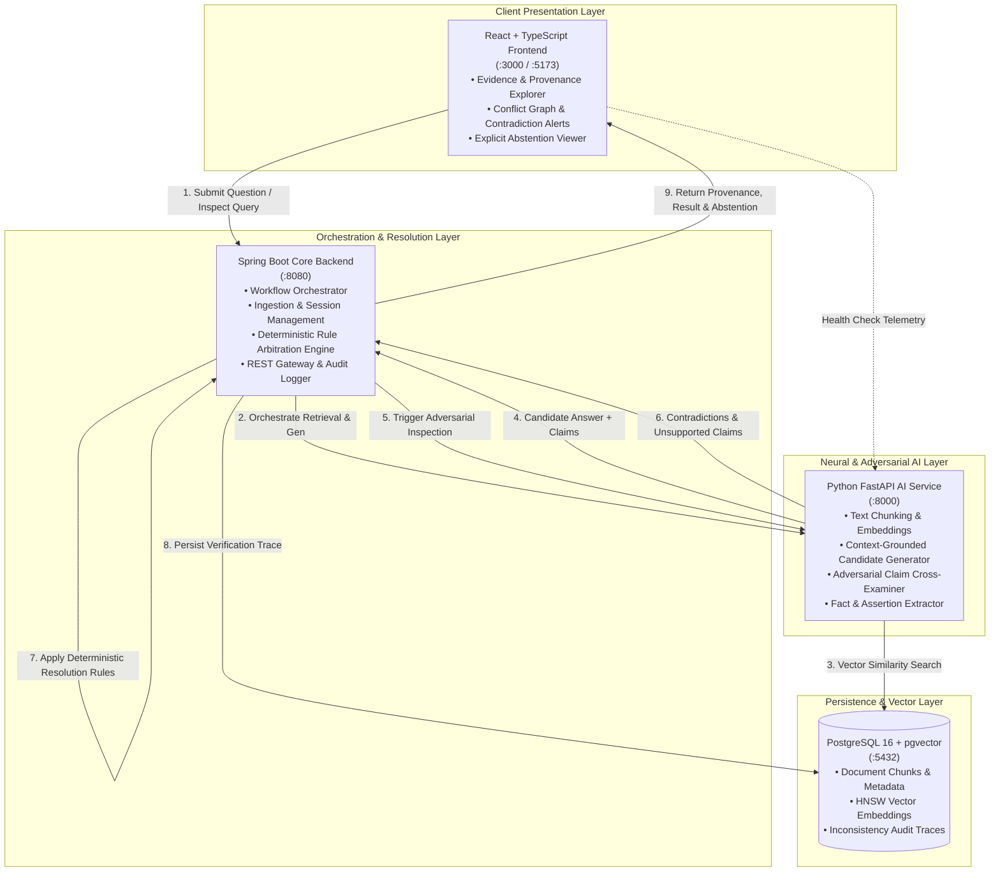

# TruthGuard 🛡️

**Adversarial Verification System for Question Answering Over Inconsistent Document Corpora**

TruthGuard is an enterprise-grade question answering and verification system engineered to combat epistemic drift, contradictory assertions, stale information, and hallucinated consensus across inconsistent document collections.

---

## Core Guarantees & Principles

1. **Retrieve Evidence Relevant to a Question**: Dense semantic retrieval and lexical indexing over multi-source document corpora.
2. **Generate Grounded Candidate Answers**: Generate candidate answers strictly anchored in retrieved evidence with exact claim attributions.
3. **Critically Inspect for Inconsistencies**: Adversarially inspect candidate answers for logical contradictions, unsupported assertions, and temporal drift.
4. **Deterministic Rule Resolution**: Arbitrate conflicting claims using explicit, deterministic business rules rather than stochastic model guesses.
5. **Transparent Provenance & Abstention**: Render resolved answers, source citations, conflict graphs, and explicit reasons whenever the system abstains.
6. **Zero Silent Compromise**: Never silently combine contradictory claims or claim that an action succeeded when it has not.

---

## System Architecture

TruthGuard is structured as a decoupled, multi-service architecture separating neural generation, deterministic arbitration, vector persistence, and interactive visualization.



---

## Service Responsibility Matrix

| Component | Technology | Primary Responsibilities | Strict Boundaries |
| :--- | :--- | :--- | :--- |
| **Frontend** (`frontend/`) | React 18, TypeScript, Vite | • User query submission<br>• Evidence chunk visualization<br>• Provenance trail rendering<br>• Contradiction highlights & conflict graphs<br>• Explicit abstention reason display | No direct database queries or raw LLM orchestration; communicates via REST APIs. |
| **Backend** (`backend/`) | Java 17, Spring Boot 3, Maven | • Workflow orchestration<br>• Deterministic rule resolution engine<br>• Ingestion state and session management<br>• Epistemic policy enforcement (no silent compromise)<br>• Transactional integrity and audit logging | Pure Java; no heavy embedding computations or AI agent inference logic. |
| **AI Service** (`ai-service/`) | Python 3.14, FastAPI, Uvicorn | • Dense vector embeddings<br>• Context-grounded candidate generation<br>• Adversarial cross-examination of answers<br>• Claim and atomic fact extraction | No business rule arbitration or final authority on truth; reports findings to backend. |
| **Database** (`docker-compose.yml`) | PostgreSQL 16 + `pgvector` | • Persistent document chunk storage<br>• High-dimensional vector index (`HNSW` / `IVFFlat`)<br>• Conflict and verification graph storage<br>• Schema version audit records | Storage only; all operations governed by backend and AI service. |

---

## Repository Layout

```
TruthGuard/
├── backend/                       # Spring Boot Backend (Java 17 / Maven)
│   ├── pom.xml                    # Maven build configuration
│   ├── README.md                  # Backend setup & architecture guide
│   ├── .gitignore                 # Backend-specific ignore rules
│   └── src/
│       ├── main/java/com/truthguard/
│       │   ├── TruthGuardApplication.java   # Application entrypoint
│       │   ├── controller/
│       │   │   └── HealthController.java    # /api/v1/health endpoint
│       │   └── dto/
│       │       └── HealthResponse.java      # Typed health DTO record
│       ├── main/resources/
│       │   └── application.yml              # Server & actuator configuration
│       └── test/java/com/truthguard/
│           ├── TruthGuardApplicationTests.java  # Spring context test
│           └── controller/
│               └── HealthControllerTest.java    # MockMvc endpoint tests
├── ai-service/                    # Python FastAPI AI Service
│   ├── pyproject.toml             # Project metadata & pytest configuration
│   ├── requirements.txt           # Python dependencies
│   ├── README.md                  # AI Service setup & API documentation
│   ├── .gitignore                 # Python-specific ignore rules
│   ├── app/
│   │   ├── main.py                # FastAPI app with structured logging
│   │   ├── config.py              # Typed settings (Pydantic)
│   │   ├── schemas/
│   │   │   └── health.py          # Typed Pydantic HealthResponse schema
│   │   └── api/
│   │       └── health.py          # /health and /api/v1/health endpoints
│   └── tests/
│       └── test_health.py         # Pytest test suite (3 tests)
├── frontend/                      # React + TypeScript Frontend (Vite)
│   ├── package.json               # Frontend dependencies & scripts
│   ├── tsconfig.json              # TypeScript compilation rules
│   ├── vite.config.ts             # Vite configuration with proxy rules
│   ├── index.html                 # Single page application template
│   ├── README.md                  # Frontend setup guide
│   ├── .gitignore                 # Frontend build ignores
│   └── src/
│       ├── App.tsx                # Landing page component
│       ├── main.tsx               # Application DOM mount
│       ├── index.css              # Global tokens & typography
│       ├── App.css                # Component styling
│       ├── types/                 # TypeScript interfaces
│       └── components/            # Header, Status, Architecture, Preview
├── docker/
│   └── initdb/
│       └── 01-init.sql            # PostgreSQL pgvector extension initializer
├── docker-compose.yml             # PostgreSQL 16 + pgvector container definition
├── .env.example                   # Environment variable template
├── .gitignore                     # Repository-level ignore rules
└── README.md                      # System documentation & quickstart
```

---

## Quickstart Guide

### 1. Database Setup (PostgreSQL with pgvector)

#### Option A: Docker Compose (Recommended)
```bash
docker compose up -d
```
This launches a PostgreSQL 16 instance with the official `pgvector` extension pre-installed on port `5432`, automatically executing `docker/initdb/01-init.sql`.

#### Option B: Local PostgreSQL (Fallback)
If running native PostgreSQL on your host:
```bash
psql -U postgres -h localhost -p 5432 -c "CREATE EXTENSION IF NOT EXISTS vector;"
```

---

### 2. Spring Boot Backend

#### Build and Test
```bash
cd backend
mvn clean test
```

#### Run Backend Service
```bash
cd backend
mvn spring-boot:run
```
The backend starts on `http://localhost:8080`.

**Verify Health:**
```bash
curl http://localhost:8080/api/v1/health
```
**Expected Response:**
```json
{
  "status": "UP",
  "service": "truthguard-backend",
  "version": "0.1.0",
  "timestamp": "2026-10-20T...",
  "details": {
    "role": "Core Orchestrator & Deterministic Rule Resolution",
    "database": "configured",
    "ai_service_bridge": "configured"
  }
}
```

---

### 3. Python FastAPI AI Service

#### Install Dependencies
```bash
cd ai-service
pip install -r requirements.txt
```

#### Run Tests
```bash
cd ai-service
python -m pytest
```

#### Run AI Service
```bash
cd ai-service
uvicorn app.main:app --host 0.0.0.0 --port 8000 --reload
```
The AI Service starts on `http://localhost:8000`.

**Verify Health:**
```bash
curl http://localhost:8000/health
```
**Expected Response:**
```json
{
  "status": "UP",
  "service": "truthguard-ai-service",
  "version": "0.1.0",
  "environment": "development",
  "timestamp": "2026-10-20T...",
  "details": {
    "role": "Adversarial verification, claim extraction, and embedding generation",
    "models_ready": "mock_mode_active",
    "vector_search_ready": "configured"
  }
}
```
Interactive API docs are available at `http://localhost:8000/docs`.

---

### 4. React + TypeScript Frontend

#### Install Dependencies
```bash
cd frontend
npm install
```

#### Build for Production
```bash
cd frontend
npm run build
```

#### Run Development Server
```bash
cd frontend
npm run dev
```
The frontend launches on `http://localhost:3000` (or `http://localhost:5173`).

---

## Verification & Acceptance Testing (Day 1)

All Day 1 acceptance criteria have been verified:
1. **Spring Boot Backend**: Context and endpoint unit tests run via JUnit 5/MockMvc (`mvn clean test`: 2 passed, 0 failures).
2. **FastAPI AI Service**: Health and CORS tests pass via pytest (`python -m pytest`: 3 passed in 0.97s).
3. **Frontend**: Clean TypeScript compilation (`tsc && vite build`: built in 20s with zero errors).
4. **Database**: PostgreSQL connection verified on port `5432`; Docker Compose configuration configured with `pgvector/pgvector:pg16`.
5. **No committed secrets**: `.env.example` contains only non-sensitive development defaults. All credentials ignored via `.gitignore`.
# TruthGuard

